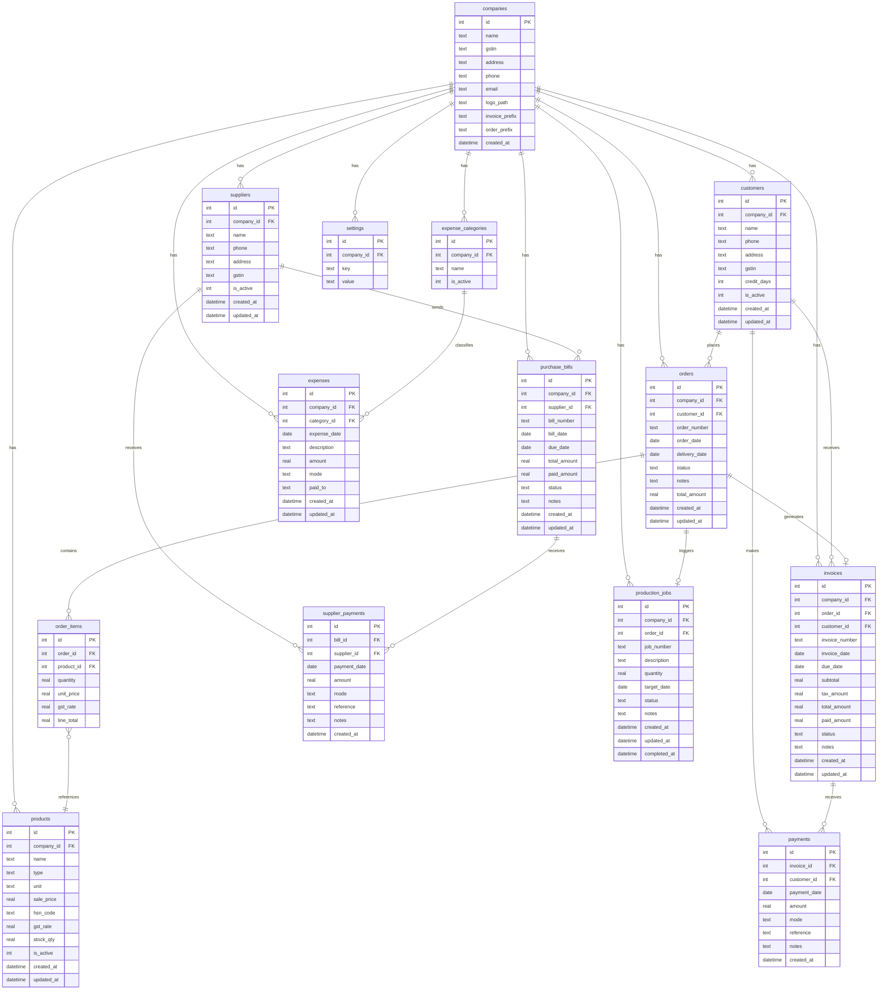

# CombERP — Database Design Document

> **Version:** 1.0
> **Date:** June 2026
> **Source of Truth:** docs/mvp_scope.md
> **Database Engine:** SQLite (MVP) — portable to PostgreSQL in v2
> **Audience:** Developers implementing the CombERP backend

---

## Table of Contents

1. [Design Principles](#1-design-principles)
2. [Enum Definitions](#2-enum-definitions)
3. [Table Definitions](#3-table-definitions)
4. [Indexes](#4-indexes)
5. [Constraints Summary](#5-constraints-summary)
6. [Entity Relationship Diagram](#6-entity-relationship-diagram)
7. [Relationships Explained](#7-relationships-explained)
8. [Data Flow Through the System](#8-data-flow-through-the-system)
9. [Example Records](#9-example-records)
10. [Design Decisions & Rationale](#10-design-decisions--rationale)

---

## 1. Design Principles

| Principle                  | Applied As                                                                 |
|----------------------------|----------------------------------------------------------------------------|
| **Simple over clever**     | Integer PKs, no polymorphism, no generic EAV tables                        |
| **Flat over deep**         | Maximum 2 levels of nesting in any query path                              |
| **Company isolation**      | Every business table carries `company_id`; queries always filter by it     |
| **Soft deletes**           | `is_active` flag instead of hard DELETE to preserve audit trail            |
| **Denormalized totals**    | `paid_amount` stored on invoices/bills (recomputed on payment write)       |
| **No BOM in MVP**          | Raw materials tracked manually; no auto-deduction from production           |
| **No stock ledger in MVP** | `stock_qty` is a direct column on `products`, manually maintained          |
| **Timestamps everywhere**  | `created_at` on every table; `updated_at` on mutable records               |

---

## 2. Enum Definitions

Enums are stored as TEXT columns in SQLite with a CHECK constraint enforcing valid values.

### 2.1 product_type
| Value           | Meaning                           |
|-----------------|-----------------------------------|
| `FINISHED_GOOD` | A comb product sold to customers  |
| `RAW_MATERIAL`  | Material used in production       |

### 2.2 order_status
| Value           | Meaning                                                 |
|-----------------|---------------------------------------------------------|
| `PENDING`       | Order received; not yet started                         |
| `IN_PRODUCTION` | Linked production job is in progress                    |
| `READY`         | Production done; awaiting dispatch                      |
| `DISPATCHED`    | Goods sent to customer                                  |
| `CANCELLED`     | Order cancelled; no invoice will be raised              |

### 2.3 invoice_status
| Value     | Meaning                                               |
|-----------|-------------------------------------------------------|
| `UNPAID`  | No payment received yet                               |
| `PARTIAL` | Some payment received; balance remains                |
| `PAID`    | Fully paid                                            |
| `OVERDUE` | Due date has passed; balance remains (auto-computed)  |

### 2.4 bill_status (purchase bills)
| Value     | Meaning                                   |
|-----------|-------------------------------------------|
| `UNPAID`  | Not yet paid to supplier                  |
| `PARTIAL` | Partially paid                            |
| `PAID`    | Fully paid                                |
| `OVERDUE` | Past due date; balance remains            |

### 2.5 job_status (production jobs)
| Value         | Meaning                                  |
|---------------|------------------------------------------|
| `PENDING`     | Job created; not yet started             |
| `IN_PROGRESS` | Production has begun                     |
| `DONE`        | Production completed                     |
| `CANCELLED`   | Job cancelled                            |

### 2.6 payment_mode
| Value    | Meaning                      |
|----------|------------------------------|
| `CASH`   | Physical cash                |
| `UPI`    | UPI (GPay, PhonePe, etc.)    |
| `BANK`   | Bank transfer / NEFT / RTGS  |
| `CHEQUE` | Cheque payment               |
| `OTHER`  | Any other mode               |

---

## 3. Table Definitions

### 14 Tables at a Glance

| #  | Table Name            | Purpose                                          |
|----|-----------------------|--------------------------------------------------|
| 1  | `companies`           | The two manufacturing companies                  |
| 2  | `customers`           | Buyers of comb products                          |
| 3  | `suppliers`           | Raw material vendors                             |
| 4  | `products`            | Finished goods AND raw materials (unified)       |
| 5  | `orders`              | Customer orders (header)                         |
| 6  | `order_items`         | Line items within each order                     |
| 7  | `invoices`            | Sales invoices raised to customers               |
| 8  | `payments`            | Customer payment receipts against invoices       |
| 9  | `purchase_bills`      | Supplier bills received                          |
| 10 | `supplier_payments`   | Payments made to suppliers                       |
| 11 | `production_jobs`     | Production tracking linked to orders             |
| 12 | `expenses`            | Daily business expenses                          |
| 13 | `expense_categories`  | Configurable list of expense categories          |
| 14 | `settings`            | Per-company key-value configuration              |

---

### Table 1: `companies`

**Purpose:** Stores the two manufacturing company profiles. Every business transaction in the system is scoped to one of these companies. The owner switches between companies from the top navigation bar.

| Column           | Type         | Nullable | Default | Description                                |
|------------------|--------------|----------|---------|--------------------------------------------|
| `id`             | INTEGER      | NO       | auto    | Primary key, auto-increment                |
| `name`           | TEXT         | NO       | —       | Legal company name                         |
| `gstin`          | TEXT         | YES      | NULL    | GST Identification Number (15 chars)       |
| `address`        | TEXT         | YES      | NULL    | Registered address                         |
| `phone`          | TEXT         | YES      | NULL    | Contact phone number                       |
| `email`          | TEXT         | YES      | NULL    | Contact email                              |
| `logo_path`      | TEXT         | YES      | NULL    | File system path to company logo image     |
| `invoice_prefix` | TEXT         | NO       | 'INV'   | Prefix for invoice numbers (e.g., "INV")   |
| `order_prefix`   | TEXT         | NO       | 'ORD'   | Prefix for order numbers (e.g., "ORD")     |
| `created_at`     | DATETIME     | NO       | now()   | Record creation timestamp                  |

**Primary Key:** `id`
**Constraints:**
- `name` NOT NULL, NOT EMPTY

---

### Table 2: `customers`

**Purpose:** Master list of all buyers who place comb orders. The outstanding balance a customer owes is computed from their invoices and payments — it is never stored directly here to avoid sync issues.

| Column         | Type     | Nullable | Default | Description                                          |
|----------------|----------|----------|---------|------------------------------------------------------|
| `id`           | INTEGER  | NO       | auto    | Primary key                                          |
| `company_id`   | INTEGER  | NO       | —       | FK → companies.id                                    |
| `name`         | TEXT     | NO       | —       | Customer / firm name                                 |
| `phone`        | TEXT     | YES      | NULL    | Primary phone number                                 |
| `address`      | TEXT     | YES      | NULL    | Delivery / billing address                           |
| `gstin`        | TEXT     | YES      | NULL    | Customer GSTIN (for B2B invoices)                    |
| `credit_days`  | INTEGER  | NO       | 30      | Default payment terms in days                        |
| `is_active`    | INTEGER  | NO       | 1       | Soft delete flag (1 = active, 0 = archived)          |
| `created_at`   | DATETIME | NO       | now()   | Record creation timestamp                            |
| `updated_at`   | DATETIME | NO       | now()   | Last update timestamp                                |

**Primary Key:** `id`
**Foreign Keys:**
- `company_id` → `companies(id)` ON DELETE RESTRICT

**Constraints:**
- `name` NOT NULL, NOT EMPTY
- `credit_days` >= 0
- `is_active` IN (0, 1)

---

### Table 3: `suppliers`

**Purpose:** Master list of raw material vendors. The amount owed to each supplier is computed from purchase bills and supplier payments — never stored directly here.

| Column       | Type     | Nullable | Default | Description                                 |
|--------------|----------|----------|---------|---------------------------------------------|
| `id`         | INTEGER  | NO       | auto    | Primary key                                 |
| `company_id` | INTEGER  | NO       | —       | FK → companies.id                           |
| `name`       | TEXT     | NO       | —       | Supplier / firm name                        |
| `phone`      | TEXT     | YES      | NULL    | Primary phone number                        |
| `address`    | TEXT     | YES      | NULL    | Supplier address                            |
| `gstin`      | TEXT     | YES      | NULL    | Supplier GSTIN                              |
| `is_active`  | INTEGER  | NO       | 1       | Soft delete flag (1 = active, 0 = archived) |
| `created_at` | DATETIME | NO       | now()   | Record creation timestamp                   |
| `updated_at` | DATETIME | NO       | now()   | Last update timestamp                       |

**Primary Key:** `id`
**Foreign Keys:**
- `company_id` → `companies(id)` ON DELETE RESTRICT

**Constraints:**
- `name` NOT NULL, NOT EMPTY
- `is_active` IN (0, 1)

---

### Table 4: `products`

**Purpose:** Unified catalogue for both finished comb products (sold to customers) and raw materials (purchased from suppliers). The `type` column distinguishes them. This avoids maintaining two separate tables with identical structure.

| Column       | Type          | Nullable | Default | Description                                        |
|--------------|---------------|----------|---------|----------------------------------------------------|
| `id`         | INTEGER       | NO       | auto    | Primary key                                        |
| `company_id` | INTEGER       | NO       | —       | FK → companies.id                                  |
| `name`       | TEXT          | NO       | —       | Product or material name                           |
| `type`       | TEXT          | NO       | —       | ENUM: `FINISHED_GOOD` or `RAW_MATERIAL`            |
| `unit`       | TEXT          | NO       | 'Pcs'   | Unit of measure (Pcs, Dozen, Box, Kg, etc.)        |
| `sale_price` | REAL          | NO       | 0.00    | Default selling price (0 for raw materials)        |
| `hsn_code`   | TEXT          | YES      | NULL    | HSN/SAC code for GST (finished goods only)         |
| `gst_rate`   | REAL          | NO       | 0.00    | GST percentage (e.g., 18.00)                       |
| `stock_qty`  | REAL          | NO       | 0.00    | Current stock — manually maintained by owner       |
| `is_active`  | INTEGER       | NO       | 1       | Soft delete flag (1 = active, 0 = archived)        |
| `created_at` | DATETIME      | NO       | now()   | Record creation timestamp                          |
| `updated_at` | DATETIME      | NO       | now()   | Last update timestamp                              |

**Primary Key:** `id`
**Foreign Keys:**
- `company_id` → `companies(id)` ON DELETE RESTRICT

**Constraints:**
- `name` NOT NULL, NOT EMPTY
- `type` IN ('FINISHED_GOOD', 'RAW_MATERIAL')
- `sale_price` >= 0.00
- `gst_rate` >= 0.00 AND `gst_rate` <= 100.00
- `stock_qty` >= 0.00
- `is_active` IN (0, 1)

---

### Table 5: `orders`

**Purpose:** Captures the header of a customer order. Each order can contain multiple line items (stored in `order_items`). Orders drive the entire downstream workflow — invoice generation and production job creation both originate here.

| Column          | Type          | Nullable | Default     | Description                                            |
|-----------------|---------------|----------|-------------|--------------------------------------------------------|
| `id`            | INTEGER       | NO       | auto        | Primary key                                            |
| `company_id`    | INTEGER       | NO       | —           | FK → companies.id                                      |
| `customer_id`   | INTEGER       | NO       | —           | FK → customers.id                                      |
| `order_number`  | TEXT          | NO       | —           | Human-readable number (e.g., ORD-2026-0042)            |
| `order_date`    | DATE          | NO       | today()     | Date order was received                                |
| `delivery_date` | DATE          | YES      | NULL        | Expected delivery date (can be blank)                  |
| `status`        | TEXT          | NO       | 'PENDING'   | ENUM: order_status values                              |
| `notes`         | TEXT          | YES      | NULL        | Customer special instructions                          |
| `total_amount`  | REAL          | NO       | 0.00        | Sum of all order_items.line_total (pre-tax)            |
| `created_at`    | DATETIME      | NO       | now()       | Record creation timestamp                              |
| `updated_at`    | DATETIME      | NO       | now()       | Last update timestamp                                  |

**Primary Key:** `id`
**Foreign Keys:**
- `company_id` → `companies(id)` ON DELETE RESTRICT
- `customer_id` → `customers(id)` ON DELETE RESTRICT

**Constraints:**
- `order_number` UNIQUE (within the application, enforced at service layer)
- `status` IN ('PENDING', 'IN_PRODUCTION', 'READY', 'DISPATCHED', 'CANCELLED')
- `total_amount` >= 0.00

---

### Table 6: `order_items`

**Purpose:** Each row is one product line within an order. Prices and GST rates are captured at the time of order creation — this preserves the historical price even if the product's current price is later changed.

| Column       | Type     | Nullable | Default | Description                                                    |
|--------------|----------|----------|---------|----------------------------------------------------------------|
| `id`         | INTEGER  | NO       | auto    | Primary key                                                    |
| `order_id`   | INTEGER  | NO       | —       | FK → orders.id                                                 |
| `product_id` | INTEGER  | NO       | —       | FK → products.id                                               |
| `quantity`   | REAL     | NO       | —       | Quantity ordered                                               |
| `unit_price` | REAL     | NO       | —       | Selling price per unit at time of order (snapshot)             |
| `gst_rate`   | REAL     | NO       | 0.00    | GST % at time of order (snapshot)                              |
| `line_total` | REAL     | NO       | —       | quantity × unit_price (pre-tax subtotal for this line)         |

**Primary Key:** `id`
**Foreign Keys:**
- `order_id` → `orders(id)` ON DELETE CASCADE
- `product_id` → `products(id)` ON DELETE RESTRICT

**Constraints:**
- `quantity` > 0
- `unit_price` >= 0
- `gst_rate` >= 0 AND `gst_rate` <= 100
- `line_total` >= 0

> **Note:** When an order is deleted (rare, should be cancelled instead), all its items are cascade-deleted.

---

### Table 7: `invoices`

**Purpose:** A formal invoice raised to a customer, usually generated from an order. Tracks the full payment lifecycle: total amount, how much has been paid, and current status. The `paid_amount` column is updated each time a payment is recorded, avoiding expensive recalculation on every read.

| Column           | Type     | Nullable | Default   | Description                                             |
|------------------|----------|----------|-----------|---------------------------------------------------------|
| `id`             | INTEGER  | NO       | auto      | Primary key                                             |
| `company_id`     | INTEGER  | NO       | —         | FK → companies.id                                       |
| `order_id`       | INTEGER  | YES      | NULL      | FK → orders.id (nullable for standalone invoices)       |
| `customer_id`    | INTEGER  | NO       | —         | FK → customers.id                                       |
| `invoice_number` | TEXT     | NO       | —         | Human-readable number (e.g., INV-2026-0087)             |
| `invoice_date`   | DATE     | NO       | today()   | Date of invoice                                         |
| `due_date`       | DATE     | NO       | —         | invoice_date + customer.credit_days                     |
| `subtotal`       | REAL     | NO       | 0.00      | Total before tax                                        |
| `tax_amount`     | REAL     | NO       | 0.00      | Total GST amount                                        |
| `total_amount`   | REAL     | NO       | 0.00      | subtotal + tax_amount (grand total)                     |
| `paid_amount`    | REAL     | NO       | 0.00      | Sum of all linked payments (updated on payment write)   |
| `status`         | TEXT     | NO       | 'UNPAID'  | ENUM: invoice_status values                             |
| `notes`          | TEXT     | YES      | NULL      | Any notes on the invoice                                |
| `created_at`     | DATETIME | NO       | now()     | Record creation timestamp                               |
| `updated_at`     | DATETIME | NO       | now()     | Last update timestamp                                   |

**Primary Key:** `id`
**Foreign Keys:**
- `company_id` → `companies(id)` ON DELETE RESTRICT
- `order_id` → `orders(id)` ON DELETE RESTRICT (nullable)
- `customer_id` → `customers(id)` ON DELETE RESTRICT

**Constraints:**
- `invoice_number` UNIQUE (enforced at service layer per company per financial year)
- `status` IN ('UNPAID', 'PARTIAL', 'PAID', 'OVERDUE')
- `subtotal` >= 0
- `tax_amount` >= 0
- `total_amount` >= 0
- `paid_amount` >= 0
- `paid_amount` <= `total_amount`

**Derived / Computed:**
- `balance_due` = `total_amount` - `paid_amount` (computed in queries, not stored)
- Status auto-transitions: if `due_date` < today AND `paid_amount` < `total_amount`, status = `OVERDUE`

---

### Table 8: `payments`

**Purpose:** Records every payment receipt from a customer against a specific invoice. Each row is one payment event. Multiple partial payments on one invoice are supported. The `invoice.paid_amount` is updated each time a payment is inserted.

| Column         | Type     | Nullable | Default | Description                                    |
|----------------|----------|----------|---------|------------------------------------------------|
| `id`           | INTEGER  | NO       | auto    | Primary key                                    |
| `invoice_id`   | INTEGER  | NO       | —       | FK → invoices.id                               |
| `customer_id`  | INTEGER  | NO       | —       | FK → customers.id (denormalized for queries)   |
| `payment_date` | DATE     | NO       | today() | Date payment was received                      |
| `amount`       | REAL     | NO       | —       | Amount received in this payment                |
| `mode`         | TEXT     | NO       | 'CASH'  | ENUM: payment_mode values                      |
| `reference`    | TEXT     | YES      | NULL    | Cheque number, UPI transaction ID, UTR, etc.   |
| `notes`        | TEXT     | YES      | NULL    | Any additional notes                           |
| `created_at`   | DATETIME | NO       | now()   | Record creation timestamp                      |

**Primary Key:** `id`
**Foreign Keys:**
- `invoice_id` → `invoices(id)` ON DELETE RESTRICT
- `customer_id` → `customers(id)` ON DELETE RESTRICT

**Constraints:**
- `amount` > 0
- `mode` IN ('CASH', 'UPI', 'BANK', 'CHEQUE', 'OTHER')

**Business Rule (enforced at service layer):**
- The total of all payments for an invoice must not exceed `invoice.total_amount`

---

### Table 9: `purchase_bills`

**Purpose:** Records supplier invoices received when buying raw materials. Tracks how much has been paid and outstanding balance. Mirrors the `invoices` table structure but for the payables side of the business.

| Column         | Type     | Nullable | Default  | Description                                              |
|----------------|----------|----------|----------|----------------------------------------------------------|
| `id`           | INTEGER  | NO       | auto     | Primary key                                              |
| `company_id`   | INTEGER  | NO       | —        | FK → companies.id                                        |
| `supplier_id`  | INTEGER  | NO       | —        | FK → suppliers.id                                        |
| `bill_number`  | TEXT     | YES      | NULL     | Supplier's own invoice/bill number                       |
| `bill_date`    | DATE     | NO       | today()  | Date of supplier's bill                                  |
| `due_date`     | DATE     | YES      | NULL     | Payment due date                                         |
| `total_amount` | REAL     | NO       | —        | Total amount owed to supplier                            |
| `paid_amount`  | REAL     | NO       | 0.00     | Sum of all linked supplier payments                      |
| `status`       | TEXT     | NO       | 'UNPAID' | ENUM: bill_status values                                 |
| `notes`        | TEXT     | YES      | NULL     | Any notes                                                |
| `created_at`   | DATETIME | NO       | now()    | Record creation timestamp                                |
| `updated_at`   | DATETIME | NO       | now()    | Last update timestamp                                    |

**Primary Key:** `id`
**Foreign Keys:**
- `company_id` → `companies(id)` ON DELETE RESTRICT
- `supplier_id` → `suppliers(id)` ON DELETE RESTRICT

**Constraints:**
- `total_amount` > 0
- `paid_amount` >= 0
- `paid_amount` <= `total_amount`
- `status` IN ('UNPAID', 'PARTIAL', 'PAID', 'OVERDUE')

**Derived / Computed:**
- `balance_due` = `total_amount` - `paid_amount` (computed in queries, not stored)

---

### Table 10: `supplier_payments`

**Purpose:** Records each payment made to a supplier against a specific purchase bill. One bill may be settled in multiple partial payments.

| Column         | Type     | Nullable | Default | Description                                      |
|----------------|----------|----------|---------|--------------------------------------------------|
| `id`           | INTEGER  | NO       | auto    | Primary key                                      |
| `bill_id`      | INTEGER  | NO       | —       | FK → purchase_bills.id                           |
| `supplier_id`  | INTEGER  | NO       | —       | FK → suppliers.id (denormalized for queries)     |
| `payment_date` | DATE     | NO       | today() | Date payment was made                            |
| `amount`       | REAL     | NO       | —       | Amount paid in this payment                      |
| `mode`         | TEXT     | NO       | 'CASH'  | ENUM: payment_mode values                        |
| `reference`    | TEXT     | YES      | NULL    | Transaction ID, cheque number, etc.              |
| `notes`        | TEXT     | YES      | NULL    | Any additional notes                             |
| `created_at`   | DATETIME | NO       | now()   | Record creation timestamp                        |

**Primary Key:** `id`
**Foreign Keys:**
- `bill_id` → `purchase_bills(id)` ON DELETE RESTRICT
- `supplier_id` → `suppliers(id)` ON DELETE RESTRICT

**Constraints:**
- `amount` > 0
- `mode` IN ('CASH', 'UPI', 'BANK', 'CHEQUE', 'OTHER')

---

### Table 11: `production_jobs`

**Purpose:** Tracks what is being manufactured in response to customer orders. In MVP, this is a simple status tracker — the owner updates it manually as work progresses. There is no BOM or automatic material deduction.

| Column          | Type     | Nullable | Default   | Description                                              |
|-----------------|----------|----------|-----------|----------------------------------------------------------|
| `id`            | INTEGER  | NO       | auto      | Primary key                                              |
| `company_id`    | INTEGER  | NO       | —         | FK → companies.id                                        |
| `order_id`      | INTEGER  | NO       | —         | FK → orders.id (every job is linked to an order)         |
| `job_number`    | TEXT     | NO       | —         | Human-readable number (e.g., JOB-2026-0018)              |
| `description`   | TEXT     | YES      | NULL      | What is being produced                                   |
| `quantity`      | REAL     | NO       | —         | Planned production quantity                              |
| `target_date`   | DATE     | YES      | NULL      | Expected completion date                                 |
| `status`        | TEXT     | NO       | 'PENDING' | ENUM: job_status values                                  |
| `notes`         | TEXT     | YES      | NULL      | Production notes                                         |
| `created_at`    | DATETIME | NO       | now()     | Record creation timestamp                                |
| `updated_at`    | DATETIME | NO       | now()     | Last update timestamp                                    |
| `completed_at`  | DATETIME | YES      | NULL      | Set when status changes to DONE                          |

**Primary Key:** `id`
**Foreign Keys:**
- `company_id` → `companies(id)` ON DELETE RESTRICT
- `order_id` → `orders(id)` ON DELETE RESTRICT

**Constraints:**
- `status` IN ('PENDING', 'IN_PROGRESS', 'DONE', 'CANCELLED')
- `quantity` > 0

---

### Table 12: `expenses`

**Purpose:** Records every business expense incurred — wages, freight, utilities, consumables, rent, etc. All categorised so the owner can see where money is going.

| Column         | Type     | Nullable | Default | Description                                        |
|----------------|----------|----------|---------|----------------------------------------------------|
| `id`           | INTEGER  | NO       | auto    | Primary key                                        |
| `company_id`   | INTEGER  | NO       | —       | FK → companies.id                                  |
| `category_id`  | INTEGER  | NO       | —       | FK → expense_categories.id                         |
| `expense_date` | DATE     | NO       | today() | Date expense was incurred                          |
| `description`  | TEXT     | YES      | NULL    | Brief description                                  |
| `amount`       | REAL     | NO       | —       | Amount spent                                       |
| `mode`         | TEXT     | NO       | 'CASH'  | ENUM: payment_mode values (excluding CHEQUE)       |
| `paid_to`      | TEXT     | YES      | NULL    | Vendor name, employee name, etc.                   |
| `created_at`   | DATETIME | NO       | now()   | Record creation timestamp                          |
| `updated_at`   | DATETIME | NO       | now()   | Last update timestamp                              |

**Primary Key:** `id`
**Foreign Keys:**
- `company_id` → `companies(id)` ON DELETE RESTRICT
- `category_id` → `expense_categories(id)` ON DELETE RESTRICT

**Constraints:**
- `amount` > 0
- `mode` IN ('CASH', 'UPI', 'BANK', 'OTHER')

---

### Table 13: `expense_categories`

**Purpose:** A configurable list of expense categories. The owner can add or rename categories from the Settings screen without touching code. Pre-seeded with common categories on first run.

| Column       | Type     | Nullable | Default | Description                                 |
|--------------|----------|----------|---------|---------------------------------------------|
| `id`         | INTEGER  | NO       | auto    | Primary key                                 |
| `company_id` | INTEGER  | NO       | —       | FK → companies.id                           |
| `name`       | TEXT     | NO       | —       | Category name (e.g., Wages, Rent, Freight)  |
| `is_active`  | INTEGER  | NO       | 1       | Soft delete flag (1 = active, 0 = hidden)   |

**Primary Key:** `id`
**Foreign Keys:**
- `company_id` → `companies(id)` ON DELETE RESTRICT

**Constraints:**
- `name` NOT NULL, NOT EMPTY
- `is_active` IN (0, 1)
- UNIQUE (`company_id`, `name`) — no duplicate category names per company

---

### Table 14: `settings`

**Purpose:** A key-value store for per-company configuration that does not warrant its own table. Used for things like the next invoice number counter and the current financial year.

| Column       | Type    | Nullable | Default | Description                                      |
|--------------|---------|----------|---------|--------------------------------------------------|
| `id`         | INTEGER | NO       | auto    | Primary key                                      |
| `company_id` | INTEGER | NO       | —       | FK → companies.id                                |
| `key`        | TEXT    | NO       | —       | Setting name (e.g., `invoice_next_number`)       |
| `value`      | TEXT    | NO       | —       | Setting value (stored as text; cast as needed)   |

**Primary Key:** `id`
**Foreign Keys:**
- `company_id` → `companies(id)` ON DELETE RESTRICT

**Constraints:**
- UNIQUE (`company_id`, `key`) — one value per key per company

**Pre-seeded Keys:**

| Key                    | Default Value | Description                           |
|------------------------|---------------|---------------------------------------|
| `invoice_next_number`  | `1`           | Auto-incremented invoice counter      |
| `order_next_number`    | `1`           | Auto-incremented order counter        |
| `job_next_number`      | `1`           | Auto-incremented production job counter |
| `financial_year`       | `2026-27`     | Current financial year label          |

---

## 4. Indexes

Indexes are defined to speed up the most common query patterns: listing records by company, filtering by status, searching by name/number, and joining on foreign keys.

### `companies`
| Index Name              | Columns  | Type   | Purpose                    |
|-------------------------|----------|--------|----------------------------|
| `companies_pkey`        | `id`     | UNIQUE | Primary key (auto-created) |

### `customers`
| Index Name                     | Columns                    | Type   | Purpose                                |
|--------------------------------|----------------------------|--------|----------------------------------------|
| `customers_pkey`               | `id`                       | UNIQUE | Primary key                            |
| `idx_customers_company`        | `company_id`               | BTREE  | Filter all customers by company        |
| `idx_customers_name`           | `company_id, name`         | BTREE  | Customer search by name within company |
| `idx_customers_active`         | `company_id, is_active`    | BTREE  | List only active customers             |

### `suppliers`
| Index Name                     | Columns                    | Type   | Purpose                                |
|--------------------------------|----------------------------|--------|----------------------------------------|
| `suppliers_pkey`               | `id`                       | UNIQUE | Primary key                            |
| `idx_suppliers_company`        | `company_id`               | BTREE  | Filter suppliers by company            |
| `idx_suppliers_name`           | `company_id, name`         | BTREE  | Supplier search by name                |

### `products`
| Index Name                     | Columns                    | Type   | Purpose                                |
|--------------------------------|----------------------------|--------|----------------------------------------|
| `products_pkey`                | `id`                       | UNIQUE | Primary key                            |
| `idx_products_company_type`    | `company_id, type`         | BTREE  | List finished goods vs. raw materials  |
| `idx_products_active`          | `company_id, is_active`    | BTREE  | Exclude archived products              |

### `orders`
| Index Name                     | Columns                      | Type   | Purpose                                  |
|--------------------------------|------------------------------|--------|------------------------------------------|
| `orders_pkey`                  | `id`                         | UNIQUE | Primary key                              |
| `idx_orders_company_status`    | `company_id, status`         | BTREE  | Filter orders by status (most common)    |
| `idx_orders_customer`          | `customer_id`                | BTREE  | Get all orders for a customer            |
| `idx_orders_date`              | `company_id, order_date`     | BTREE  | Date-range filtering on order list       |
| `idx_orders_number`            | `company_id, order_number`   | UNIQUE | Ensure unique order numbers per company  |

### `order_items`
| Index Name                     | Columns                    | Type   | Purpose                                |
|--------------------------------|----------------------------|--------|----------------------------------------|
| `order_items_pkey`             | `id`                       | UNIQUE | Primary key                            |
| `idx_order_items_order`        | `order_id`                 | BTREE  | Fetch all items for an order           |
| `idx_order_items_product`      | `product_id`               | BTREE  | Find orders containing a product       |

### `invoices`
| Index Name                     | Columns                        | Type   | Purpose                                   |
|--------------------------------|--------------------------------|--------|-------------------------------------------|
| `invoices_pkey`                | `id`                           | UNIQUE | Primary key                               |
| `idx_invoices_company_status`  | `company_id, status`           | BTREE  | Filter by payment status                  |
| `idx_invoices_customer`        | `customer_id`                  | BTREE  | Get all invoices for a customer           |
| `idx_invoices_date`            | `company_id, invoice_date`     | BTREE  | Date-range filtering for Sales Register   |
| `idx_invoices_due_date`        | `company_id, due_date`         | BTREE  | Find overdue invoices                     |
| `idx_invoices_number`          | `company_id, invoice_number`   | UNIQUE | Ensure unique invoice numbers per company |
| `idx_invoices_order`           | `order_id`                     | BTREE  | Find invoice generated from an order      |

### `payments`
| Index Name                     | Columns                    | Type   | Purpose                                |
|--------------------------------|----------------------------|--------|----------------------------------------|
| `payments_pkey`                | `id`                       | UNIQUE | Primary key                            |
| `idx_payments_invoice`         | `invoice_id`               | BTREE  | Fetch payments for an invoice          |
| `idx_payments_customer`        | `customer_id`              | BTREE  | Fetch all payments from a customer     |
| `idx_payments_date`            | `payment_date`             | BTREE  | Date-range payment queries             |

### `purchase_bills`
| Index Name                     | Columns                        | Type   | Purpose                                |
|--------------------------------|--------------------------------|--------|----------------------------------------|
| `purchase_bills_pkey`          | `id`                           | UNIQUE | Primary key                            |
| `idx_bills_company_status`     | `company_id, status`           | BTREE  | Filter bills by payment status         |
| `idx_bills_supplier`           | `supplier_id`                  | BTREE  | Get all bills for a supplier           |
| `idx_bills_date`               | `company_id, bill_date`        | BTREE  | Date-range filtering                   |
| `idx_bills_due_date`           | `company_id, due_date`         | BTREE  | Find overdue bills                     |

### `supplier_payments`
| Index Name                     | Columns                    | Type   | Purpose                                  |
|--------------------------------|----------------------------|--------|------------------------------------------|
| `supplier_payments_pkey`       | `id`                       | UNIQUE | Primary key                              |
| `idx_spayments_bill`           | `bill_id`                  | BTREE  | Fetch payments for a bill                |
| `idx_spayments_supplier`       | `supplier_id`              | BTREE  | Fetch all payments made to a supplier    |

### `production_jobs`
| Index Name                     | Columns                        | Type   | Purpose                                |
|--------------------------------|--------------------------------|--------|----------------------------------------|
| `production_jobs_pkey`         | `id`                           | UNIQUE | Primary key                            |
| `idx_jobs_company_status`      | `company_id, status`           | BTREE  | Filter jobs by status                  |
| `idx_jobs_order`               | `order_id`                     | BTREE  | Find jobs linked to an order           |
| `idx_jobs_date`                | `company_id, target_date`      | BTREE  | Date-range filtering                   |

### `expenses`
| Index Name                     | Columns                        | Type   | Purpose                                |
|--------------------------------|--------------------------------|--------|----------------------------------------|
| `expenses_pkey`                | `id`                           | UNIQUE | Primary key                            |
| `idx_expenses_company_date`    | `company_id, expense_date`     | BTREE  | Date-range and monthly totals          |
| `idx_expenses_category`        | `category_id`                  | BTREE  | Group expenses by category             |

### `expense_categories`
| Index Name                     | Columns              | Type   | Purpose                                  |
|--------------------------------|----------------------|--------|------------------------------------------|
| `expense_categories_pkey`      | `id`                 | UNIQUE | Primary key                              |
| `idx_ecategories_company`      | `company_id`         | BTREE  | List categories for a company            |
| `uq_ecategories_name`          | `company_id, name`   | UNIQUE | Prevent duplicate category names         |

### `settings`
| Index Name                     | Columns              | Type   | Purpose                                  |
|--------------------------------|----------------------|--------|------------------------------------------|
| `settings_pkey`                | `id`                 | UNIQUE | Primary key                              |
| `uq_settings_key`              | `company_id, key`    | UNIQUE | One value per key per company            |

---

## 5. Constraints Summary

| Table              | Constraint Type | Rule                                                                          |
|--------------------|-----------------|-------------------------------------------------------------------------------|
| `companies`        | NOT NULL        | `name`, `invoice_prefix`, `order_prefix`                                      |
| `customers`        | NOT NULL        | `name`, `company_id`, `credit_days`                                           |
| `customers`        | CHECK           | `credit_days >= 0`, `is_active IN (0, 1)`                                     |
| `suppliers`        | NOT NULL        | `name`, `company_id`                                                          |
| `products`         | CHECK           | `type IN ('FINISHED_GOOD','RAW_MATERIAL')`, `sale_price >= 0`, `gst_rate` 0–100, `stock_qty >= 0` |
| `orders`           | CHECK           | `status IN (valid enum)`, `total_amount >= 0`                                 |
| `orders`           | UNIQUE          | `(company_id, order_number)`                                                  |
| `order_items`      | CHECK           | `quantity > 0`, `unit_price >= 0`, `line_total >= 0`                          |
| `order_items`      | CASCADE DELETE  | Deleted when parent order is deleted                                           |
| `invoices`         | CHECK           | `status IN (valid enum)`, `subtotal >= 0`, `paid_amount <= total_amount`      |
| `invoices`         | UNIQUE          | `(company_id, invoice_number)`                                                |
| `payments`         | CHECK           | `amount > 0`, `mode IN (valid enum)`                                          |
| `payments`         | SERVICE RULE    | `SUM(payments.amount) <= invoice.total_amount`                                |
| `purchase_bills`   | CHECK           | `total_amount > 0`, `paid_amount <= total_amount`, `status IN (valid enum)`   |
| `supplier_payments`| CHECK           | `amount > 0`, `mode IN (valid enum)`                                          |
| `production_jobs`  | CHECK           | `status IN (valid enum)`, `quantity > 0`                                      |
| `expenses`         | CHECK           | `amount > 0`, `mode IN (valid enum)`                                          |
| `expense_categories` | UNIQUE        | `(company_id, name)`                                                          |
| `settings`         | UNIQUE          | `(company_id, key)`                                                           |

---

## 6. Entity Relationship Diagram



---

## 7. Relationships Explained

### companies → everything
Every business entity (customer, supplier, product, order, invoice, expense) carries a `company_id`. This is the **fundamental isolation mechanism** — all queries must filter by the active company. The owner switches companies at the app level; the API injects `company_id` on every request.

### customers → orders → invoices → payments
This is the **core sales chain**:
1. A `customer` places an `order`.
2. The order gets `order_items` (one per product).
3. An `invoice` is generated from the order (or standalone).
4. The customer makes `payments` against the invoice.
5. The `paid_amount` on the invoice is updated, and status is recomputed.

### orders → production_jobs
When production is needed to fulfil an order, the owner creates a `production_job` linked to that order. An order can have one production job. The production job status does not automatically change the order status — the owner updates both manually in MVP.

### suppliers → purchase_bills → supplier_payments
This is the **payables chain**:
1. A `supplier` sends a bill (`purchase_bill`) after delivering materials.
2. The owner records the bill and its due date.
3. When payment is made, a `supplier_payment` is created.
4. The `paid_amount` on the bill is updated accordingly.

### expense_categories → expenses
Categories provide grouping for expense reporting. The `expense_categories` table is company-specific so each company can have its own category list. The `expenses.category_id` is a required foreign key — no uncategorised expenses.

---

## 8. Data Flow Through the System

### Flow 1: Customer Order → Invoice → Payment

```
Owner creates ORDER
    → order_items inserted (product snapshots: price, gst_rate captured)
    → orders.total_amount = SUM(order_items.line_total)

Owner changes order status to IN_PRODUCTION or READY or DISPATCHED
    → orders.status updated

Owner generates INVOICE from order
    → invoices row created (subtotal, tax, total computed from order_items)
    → invoices.status = 'UNPAID'
    → invoices.paid_amount = 0.00

Customer pays (partial or full)
    → payments row inserted
    → invoices.paid_amount += payment.amount
    → invoices.status recalculated:
        if paid_amount == total_amount → 'PAID'
        if paid_amount > 0 → 'PARTIAL'
        if due_date < today AND paid_amount < total_amount → 'OVERDUE'

Customer outstanding = SUM(invoices.total_amount - invoices.paid_amount)
    WHERE customer_id = X AND status != 'PAID'
```

### Flow 2: Supplier Purchase → Payment

```
Owner receives goods from supplier
    → purchase_bills row inserted
    → purchase_bills.status = 'UNPAID'
    → purchase_bills.paid_amount = 0.00

Owner makes payment to supplier
    → supplier_payments row inserted
    → purchase_bills.paid_amount += supplier_payments.amount
    → purchase_bills.status recalculated (same logic as invoices)

Supplier outstanding = SUM(purchase_bills.total_amount - purchase_bills.paid_amount)
    WHERE supplier_id = X AND status != 'PAID'
```

### Flow 3: Production Job

```
Owner confirms order needs production
    → production_jobs row created (linked to order_id)
    → production_jobs.status = 'PENDING'

Owner starts production
    → production_jobs.status = 'IN_PROGRESS'

Production complete
    → production_jobs.status = 'DONE'
    → production_jobs.completed_at = now()
    (Owner also manually updates products.stock_qty for finished goods)
```

### Flow 4: Daily Expense

```
Owner incurs expense (e.g., freight payment)
    → expenses row inserted with category_id, amount, mode, paid_to

Monthly expense report
    → GROUP BY category_id, SUM(amount)
    → WHERE company_id = X AND expense_date BETWEEN start AND end
```

### Flow 5: Dashboard Data Assembly

```
Dashboard KPIs (all computed fresh on load):

Today's Collection:
    SELECT SUM(amount) FROM payments WHERE payment_date = today

Total Customer Outstanding:
    SELECT SUM(total_amount - paid_amount) FROM invoices
    WHERE company_id = X AND status IN ('UNPAID','PARTIAL','OVERDUE')

Total Supplier Outstanding:
    SELECT SUM(total_amount - paid_amount) FROM purchase_bills
    WHERE company_id = X AND status IN ('UNPAID','PARTIAL','OVERDUE')

Open Orders Count:
    SELECT COUNT(*) FROM orders
    WHERE company_id = X AND status NOT IN ('DISPATCHED','CANCELLED')

Month Expenses:
    SELECT SUM(amount) FROM expenses
    WHERE company_id = X AND expense_date >= first_of_month
```

---

## 9. Example Records

### companies

| id | name                        | gstin             | invoice_prefix | order_prefix |
|----|-----------------------------|-------------------|----------------|--------------|
| 1  | Babu Comb Industries        | 33AABCP1234F1Z5   | INV            | ORD          |
| 2  | Sri Lakshmi Comb Works      | 33BBBCW5678G2Z1   | LCW-INV        | LCW-ORD      |

---

### customers

| id | company_id | name                  | phone       | gstin             | credit_days | is_active |
|----|------------|-----------------------|-------------|-------------------|-------------|-----------|
| 1  | 1          | Chennai Traders       | 9876543210  | 33ABCDE1234F1Z5   | 30          | 1         |
| 2  | 1          | Ravi General Store    | 9123456789  | NULL              | 15          | 1         |
| 3  | 2          | Madurai Fancy Stores  | 9988776655  | 33XYZPQ5678G2Z1   | 45          | 1         |

---

### suppliers

| id | company_id | name                  | phone       | gstin           | is_active |
|----|------------|-----------------------|-------------|-----------------|-----------|
| 1  | 1          | Plastics Wholesalers  | 9001234567  | 33PLAS1234A1Z5  | 1         |
| 2  | 1          | Sundaram Chemicals    | 9007654321  | NULL            | 1         |

---

### products

| id | company_id | name                 | type          | unit   | sale_price | hsn_code | gst_rate | stock_qty |
|----|------------|----------------------|---------------|--------|------------|----------|----------|-----------|
| 1  | 1          | Fine Tooth Comb 7"   | FINISHED_GOOD | Dozen  | 120.00     | 96151100 | 12.00    | 50        |
| 2  | 1          | Wide Tooth Comb 9"   | FINISHED_GOOD | Dozen  | 150.00     | 96151100 | 12.00    | 30        |
| 3  | 1          | Plastic Granules      | RAW_MATERIAL  | Kg     | 0.00       | NULL     | 18.00    | 200       |
| 4  | 1          | Comb Mould Set        | RAW_MATERIAL  | Pcs    | 0.00       | NULL     | 18.00    | 5         |

---

### orders

| id | company_id | customer_id | order_number  | order_date | delivery_date | status      | total_amount |
|----|------------|-------------|---------------|------------|---------------|-------------|--------------|
| 1  | 1          | 1           | ORD-2026-0001 | 2026-06-01 | 2026-06-10    | DISPATCHED  | 2400.00      |
| 2  | 1          | 2           | ORD-2026-0002 | 2026-06-05 | 2026-06-15    | IN_PRODUCTION | 1800.00    |
| 3  | 1          | 1           | ORD-2026-0003 | 2026-06-10 | 2026-06-20    | PENDING     | 3000.00      |

---

### order_items

| id | order_id | product_id | quantity | unit_price | gst_rate | line_total |
|----|----------|------------|----------|------------|----------|------------|
| 1  | 1        | 1          | 20       | 120.00     | 12.00    | 2400.00    |
| 2  | 2        | 2          | 12       | 150.00     | 12.00    | 1800.00    |
| 3  | 3        | 1          | 15       | 120.00     | 12.00    | 1800.00    |
| 4  | 3        | 2          | 8        | 150.00     | 12.00    | 1200.00    |

---

### invoices

| id | company_id | order_id | customer_id | invoice_number | invoice_date | due_date   | subtotal | tax_amount | total_amount | paid_amount | status  |
|----|------------|----------|-------------|----------------|--------------|------------|----------|------------|--------------|-------------|---------|
| 1  | 1          | 1        | 1           | INV-2026-0001  | 2026-06-10   | 2026-07-10 | 2400.00  | 288.00     | 2688.00      | 2688.00     | PAID    |
| 2  | 1          | 2        | 2           | INV-2026-0002  | 2026-06-12   | 2026-06-27 | 1800.00  | 216.00     | 2016.00      | 500.00      | PARTIAL |

---

### payments

| id | invoice_id | customer_id | payment_date | amount  | mode  | reference  |
|----|------------|-------------|--------------|---------|-------|------------|
| 1  | 1          | 1           | 2026-07-08   | 2688.00 | UPI   | TXN9876543 |
| 2  | 2          | 2           | 2026-06-15   | 500.00  | CASH  | NULL       |

---

### purchase_bills

| id | company_id | supplier_id | bill_number | bill_date  | due_date   | total_amount | paid_amount | status  |
|----|------------|-------------|-------------|------------|------------|--------------|-------------|---------|
| 1  | 1          | 1           | PW-1092     | 2026-06-03 | 2026-07-03 | 8500.00      | 8500.00     | PAID    |
| 2  | 1          | 2           | SC-0234     | 2026-06-08 | 2026-07-08 | 3200.00      | 0.00        | UNPAID  |

---

### production_jobs

| id | company_id | order_id | job_number    | description             | quantity | target_date | status      |
|----|------------|----------|---------------|-------------------------|----------|-------------|-------------|
| 1  | 1          | 2        | JOB-2026-0001 | Wide Tooth Comb 9" x 12 | 12       | 2026-06-12  | IN_PROGRESS |

---

### expenses

| id | company_id | category_id | expense_date | description        | amount  | mode  | paid_to      |
|----|------------|-------------|--------------|--------------------|---------|-------|--------------|
| 1  | 1          | 1           | 2026-06-01   | Weekly wages       | 5600.00 | CASH  | Workers      |
| 2  | 1          | 2           | 2026-06-02   | Chennai transport  | 850.00  | UPI   | SR Transports |
| 3  | 1          | 3           | 2026-06-05   | EB bill June       | 1200.00 | BANK  | TNEB         |

---

### expense_categories

| id | company_id | name        | is_active |
|----|------------|-------------|-----------|
| 1  | 1          | Wages       | 1         |
| 2  | 1          | Freight     | 1         |
| 3  | 1          | Utilities   | 1         |
| 4  | 1          | Consumables | 1         |
| 5  | 1          | Rent        | 1         |
| 6  | 1          | Other       | 1         |

---

### settings

| id | company_id | key                   | value   |
|----|------------|-----------------------|---------|
| 1  | 1          | invoice_next_number   | 3       |
| 2  | 1          | order_next_number     | 4       |
| 3  | 1          | job_next_number       | 2       |
| 4  | 1          | financial_year        | 2026-27 |
| 5  | 2          | invoice_next_number   | 1       |
| 6  | 2          | order_next_number     | 1       |
| 7  | 2          | job_next_number       | 1       |
| 8  | 2          | financial_year        | 2026-27 |

---

## 10. Design Decisions & Rationale

### Decision 1: Unified `products` table for finished goods and raw materials
**Why:** Both share identical columns (name, unit, stock). A single `type` column is simpler than maintaining two nearly identical tables (`finished_goods` and `raw_materials`) and writing separate queries and joins for each.

### Decision 2: `paid_amount` stored on `invoices` and `purchase_bills`
**Why:** Recalculating `SUM(payments.amount)` for every invoice on the Outstanding Report would be slow at scale. Storing `paid_amount` as a denormalized column and updating it on every payment write is the standard pattern for Vyapar-style applications. The trade-off is worth it.

### Decision 3: Prices snapshotted in `order_items`
**Why:** If the owner changes a product's `sale_price` later, existing historical orders and invoices must retain the price agreed at the time of order. Snapshotting `unit_price` and `gst_rate` in `order_items` prevents retroactive data corruption.

### Decision 4: No stock ledger in MVP
**Why:** Automatic stock tracking requires: BOM (bill of materials) + automatic deduction on production completion + automatic addition on purchase bill receipt. All three are deferred to v2. In MVP, the owner updates `products.stock_qty` manually — this matches the paper-based workflow they are used to.

### Decision 5: Integer PKs, not UUIDs
**Why:** CombERP is a single-owner desktop application with an SQLite local database. There is no distributed system, no data replication, and no need for globally unique identifiers. Integer auto-increment PKs are faster to index, easier to read, and simpler to work with in queries and URLs.

### Decision 6: Soft deletes via `is_active`
**Why:** Deleting a customer who has historical invoices would break referential integrity. Soft deletes let the owner "archive" a customer without losing any financial history. The application filters `WHERE is_active = 1` in all normal list views.

### Decision 7: `customer_id` denormalized into `payments` and `supplier_id` into `supplier_payments`
**Why:** The Customer Ledger and Supplier Ledger queries frequently need to aggregate payments by customer/supplier. Without this denormalization, every payment query would require a JOIN through `invoices`. The redundancy is managed: the service layer always writes both `invoice_id` and `customer_id` together.

### Decision 8: `settings` as a key-value table
**Why:** Configuration values like invoice number counters and financial year labels don't justify dedicated columns on the `companies` table (they would clutter it). A `settings` table is flexible — new config keys can be added without schema changes.

### Decision 9: `expense_categories` as a separate table (not an enum)
**Why:** Enums are code-level constants. The owner needs to add or rename expense categories from the Settings screen without a software update. A database table gives the owner full control over their category list.

### Decision 10: No `order_status` auto-sync with `production_jobs.status`
**Why:** In MVP, the owner manually updates both the order status and the production job status. Automatic status propagation (e.g., "when job is DONE, set order to READY") requires transactional event triggers and adds complexity. It is targeted for v2.

---

*End of Document*
